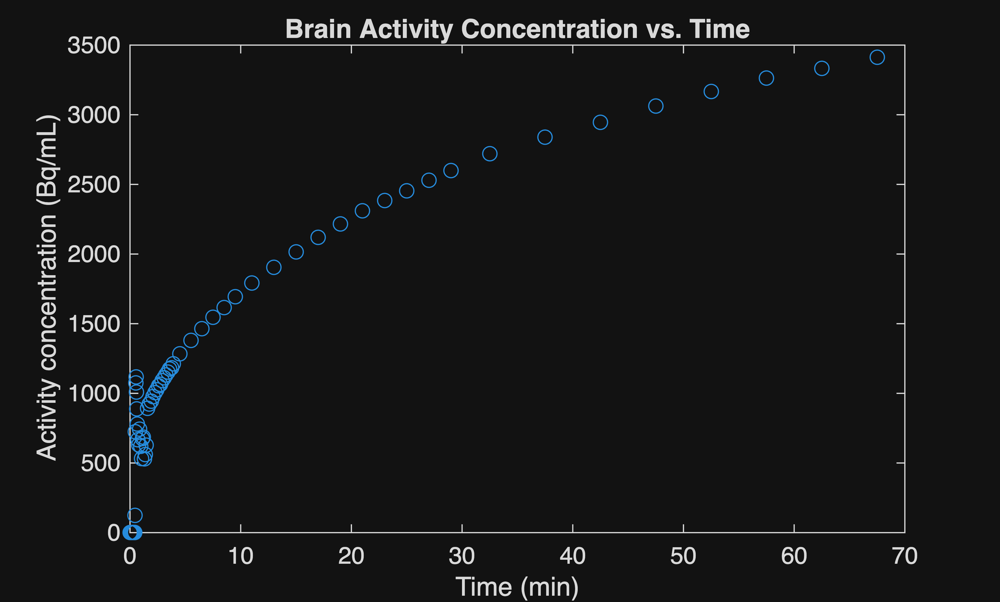
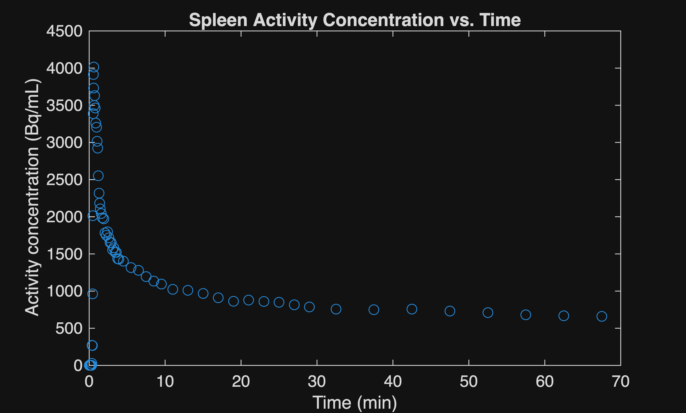
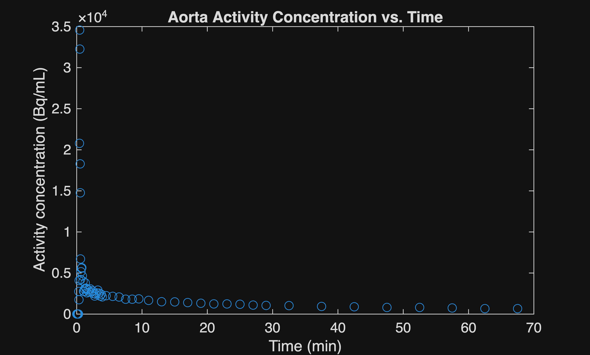
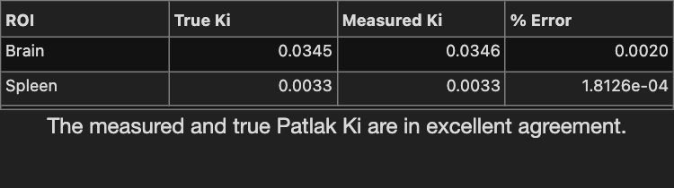

To run this code in MATLAB online, click this button: [](https://matlab.mathworks.com/open/github/v1?repo=lancedadios/Kinetic-analysis-using-Patlak-plot-method&file=kineticmodelling_short.m)

# Introduction

In this project, the Healthy Dynamic PET (hedyPET) dataset containing \[F\-18\]FDG dynamic PET/CT of 100 healthy humans was used (Hinge et al., 2026). The provided time\-activity curves (TAC) as well as image\-derived input functions (IDIF) in this dataset were used to calculate the net\-influx rate (Ki) for the brain and spleen. MATLAB was used for all data processing and analysis.

Dataset source: https://doi.org/10.1038/s41597\-026\-08157\-4

# Data loading

Load the provided TAC, IDIF, and Patlak Ki values. Due to the large file size of the provided dataset, the necessary data have been pre\-extracted for this project.

```matlab
clearvars
clc
load TACData.mat;
load IDIF.mat;
load trueKi.mat;
```

# TAC data for brain and spleen
```matlab
brainTACdata = sub000TACdata(string(sub000TACdata.("Label Name")) == "brain", :);
spleenTACdata = sub000TACdata(string(sub000TACdata.("Label Name")) == "spleen", :);
time = brainTACdata.("Frame Time Middle [s]");
brainAct = brainTACdata.("PET Mean [Bq/mL]");
spleenAct = spleenTACdata.("PET Mean [Bq/mL]");
plot(time,brainAct,'o')
title("Brain Activity Concentration vs. Time");
xlabel("Time (min)");
ylabel("Activity concentration (Bq/mL)");
```



```matlab
plot(time,spleenAct,'o')
xlabel("Time (min)");
ylabel("Activity concentration (Bq/mL)");
title("Spleen Activity Concentration vs. Time");
```



# IDIF data

In the dataset, the Ki for a single organ was calculated using different IDIFs. In this project, the IDIF measured on the ascending Aorta with a 5\-mm diameter cylinder with 3 mL volume (identifier: aortavois\_ml\-full\_width\-3\_ascending\_aorta) was used.

```matlab
aortaAct = sub000IDIFdata.("PET Mean [Bq/mL]");
plot(time,aortaAct,'o')
xlabel("Time (min)");
ylabel("Activity concentration (Bq/mL)");
title("Aorta Activity Concentration vs. Time");
```



# Estimation of net influx rate (Ki) using Patlak plot method

The Patlak plot equation is

 $$ \frac{C\left(t\right)}{\mathrm{IDIF}\left(t\right)}=K_i \frac{\;\mathrm{IDIFTIAC}\left(t\right)}{\;\mathrm{IDIF}\left(t\right)}+V_B $$ 

Where C(t) is the tracer concentration in tissue and IDIF(t) is the tracer concentration in blood.

The last eight frames will be used for calculation of Ki for a direct comparison with the provided Ki in the dataset. 

First, the integral of the IDIF at the last eight frames are calculated using the trapezoidal integration technique.

```matlab
i = size(sub000IDIFdata.("Frame Time Middle [s]"),1);
a = sub000IDIFdata.("Frame Time Middle [s]");
b = sub000IDIFdata.("PET Mean [Bq/mL]");
IDIFTIAC = cumtrapz(a,b);
```

# Estimating Ki for the brain
```matlab
PatlakY = brainTACdata.("PET Mean [Bq/mL]")(end-7:end)./sub000IDIFdata.("PET Mean [Bq/mL]")(end-7:end);
PatlakX = IDIFTIAC(end-7:end)./sub000IDIFdata.("PET Mean [Bq/mL]")(end-7:end);
coeffs = polyfit(PatlakX,PatlakY,1);
measuredbrainKi = coeffs(1);
```

# Estimating Ki for the spleen
```matlab
PatlakY = spleenTACdata.("PET Mean [Bq/mL]")(end-7:end)./sub000IDIFdata.("PET Mean [Bq/mL]")(end-7:end);
PatlakX = IDIFTIAC(end-7:end)./sub000IDIFdata.("PET Mean [Bq/mL]")(end-7:end);
coeffs = polyfit(PatlakX,PatlakY,1);
measuredspleenKi = coeffs(1);
```

# Validation of results

To validate results, the estimated net influx rates and the ones provided in the dataset are compared.

```matlab
errorBrain = ((measuredbrainKi-truebrainKi)/truebrainKi);
errorSpleen = ((measuredspleenKi-truespleenKi)/truebrainKi);
errors = [errorBrain;errorSpleen];


ROI = ["Brain"; "Spleen"];
True_Ki = [truebrainKi; truespleenKi];
Measured_Ki = [measuredbrainKi; measuredspleenKi];
errors = [errorBrain; errorSpleen];


T = table(ROI, True_Ki, Measured_Ki, errors, ...
    VariableNames = ["ROI", "True Ki", "Measured Ki", "% Error"]);


fig = uifigure('Position', [100 100 500 140]);


gl = uigridlayout(fig, [2 1]);
gl.Padding = [0 0 0 0];
gl.RowSpacing = 0;
gl.ColumnSpacing = 0;
gl.RowHeight = {'fit', 'fit'};


uit = uitable(gl, 'Data', T);
uit.Layout.Row = 1;
uit.Layout.Column = 1;
uit.FontSize = 14;


lbl = uilabel(gl, ...
    'Text', 'The measured and true Patlak Ki are in excellent agreement.', ...
    'HorizontalAlignment', 'center', ...
    'FontSize', 16);
lbl.Layout.Row = 2;
lbl.Layout.Column = 1;
```


