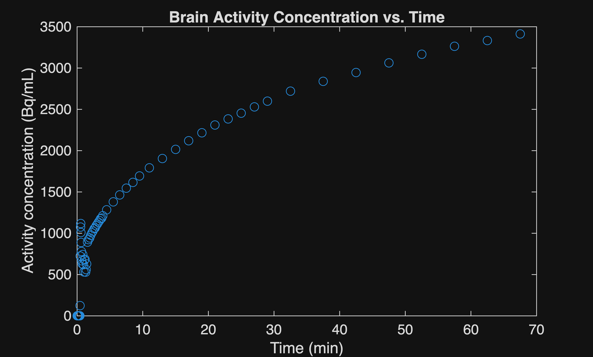
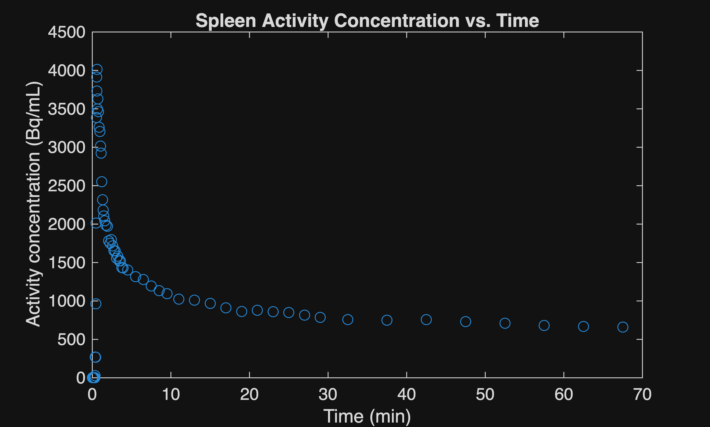
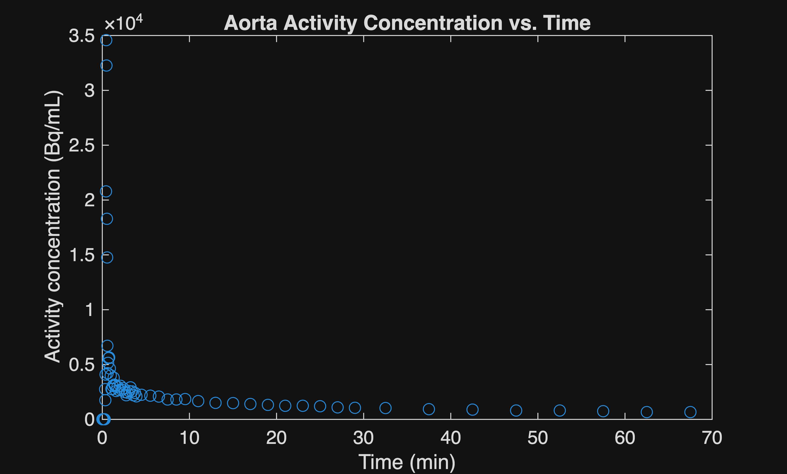
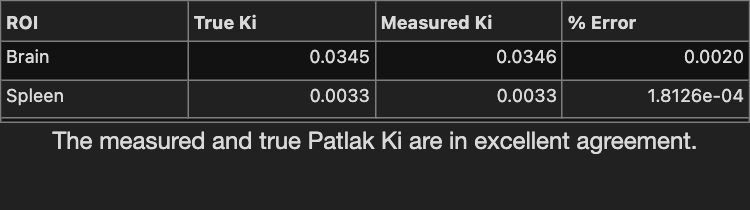

Run this code in MATLAB Online > [](https://mathworks.com)

# Introduction

In this project, the Healthy Dynamic PET (hedyPET) dataset containing \[F\-18\]FDG dynamic PET/CT of 100 healthy humans was used (Hinge et al., 2026). The provided time\-activity curves (TAC) as well as image\-derived input functions (IDIF) in this dataset were used to calculate the net\-influx rate (Ki) for the brain and spleen. MATLAB was used for all data processing and analysis.

Dataset source: https://doi.org/10.1038/s41597\-026\-08157\-4

# Data loading

Load the provided TAC. Due to the large size of the provided data, datastore function was used to read data in chunks instead of all at once.

```matlab
clearvars
clc
filepathDerivatives = fullfile('Multimodal-HC','train','derivatives','readouts');
dsDerivatives = datastore(filepathDerivatives,VariableNamingRule="preserve");
filepathTAC = dsDerivatives.Files(5);
dsTAC = tabularTextDatastore(filepathTAC,VariableNamingRule="preserve");
dsTAC.ReadSize = 10000;
filepathIDIF = dsDerivatives.Files(1);
dsIDIF = tabularTextDatastore(filepathIDIF,VariableNamingRule="preserve");
dsIDIF.ReadSize = 10000;
filepathPatlakKi = dsDerivatives.Files(4);
dsPatlakKi = tabularTextDatastore(filepathPatlakKi,VariableNamingRule="preserve");
dsPatlakKi.ReadSize = 10000;
```

# Extracting the net influx rates (Ki) provided in the dataset.
```matlab
stopper = 0;
while stopper < 2;
    i = read(dsPatlakKi);
    for j = 1:size(i,1);
        if string(i{j,'Subject'}) == "sub-000" && string(i{j,'Label Name'}) == "brain"...
                && string(i{j,'Input Function Identifier'}) == 'aortavois_ml-full_width-3_ascending_aorta';
            truebrainKi = i{j,'Patlak Ki'};
            stopper = stopper + 1;
        elseif string(i{j,'Subject'}) == "sub-000" && string(i{j,'Label Name'}) == "spleen"...
                && string(i{j,'Input Function Identifier'}) == 'aortavois_ml-full_width-3_ascending_aorta';
            truespleenKi = i{j,'Patlak Ki'};
            stopper = stopper + 1;
        end
    end
end;
clear i
clear j
clear stopper
```

# Extracting spleen and brain TAC data

Extract rows from the TAC table containing information for the spleen and brain of subject sub\-000 (a 28 year\-old male). To minimize the partial volume effect, the once\-eroded segmentation mask dataset was used.

```matlab
varTypesTAC = ["double" "cell" "cell" "double" "cell" "double" "double" "double" "double" "double"];
sub000TACdata = table(Size=[1 10],VariableTypes=varTypesTAC,VariableNames=dsTAC.VariableNames);
idx = 1;
while hasdata(dsTAC)
   i = read(dsTAC);
    for j = 1:size(i,1);
        if string(i{j,'Subject'}) == "sub-000" && (string(i{j,'Label Name'}) == "brain" || string(i{j,'Label Name'}) == "spleen") ...
                && i{j,'Erosion Iterations'} == 1;
            sub000TACdata(idx,:) = i(j,:);
            idx = idx +1;
        end
    end
end;
clear i
clear j
clear idx
%convert time unit from s to min
sub000TACdata.("Frame Time Middle [s]") = sub000TACdata.("Frame Time Middle [s]")./60;
```

Split the data according to organ.

```matlab
brainTACdata = sub000TACdata(string(sub000TACdata.("Label Name")) == "brain", :);
spleenTACdata = sub000TACdata(string(sub000TACdata.("Label Name")) == "spleen", :);
time = brainTACdata.("Frame Time Middle [s]");
brainAct = brainTACdata.("PET Mean [Bq/mL]");
spleenAct = spleenTACdata.("PET Mean [Bq/mL]");
plot(time,brainAct,'o')
title("Brain Activity Concentration vs. Time");
xlabel("Time (min)");
ylabel("Activity concentration (Bq/mL)");
```



```matlab


plot(time,spleenAct,'o')
xlabel("Time (min)");
ylabel("Activity concentration (Bq/mL)");
title("Spleen Activity Concentration vs. Time");
```



# Extracting IDIF data

In the dataset, the Ki for a single organ was calculated using different IDIFs. In this project, the IDIF with  measured on the ascending Aorta with a 5\-mm diameter cylinder and 3 mL volume (identifier: aortavois\_ml\-full\_width\-3\_ascending\_aorta) was used.

```matlab
varTypesIDIF = ["double" "cell" "cell" "double" "cell" "double" "double" "double" "double" "double"];
sub000IDIFdata = table(Size=[1 10],VariableTypes=varTypesIDIF,VariableNames=dsIDIF.VariableNames);
idx = 1;
while hasdata(dsIDIF)
    i = read(dsIDIF);
    for j = 1:size(i,1);
        if string(i{j,'Subject'}) == "sub-000" && string(i{j,'Task'}) == "aortavois_ml-full_width-3" ...
                && string(i{j,'Label Name'}) == "ascending_aorta";
            sub000IDIFdata(idx,:) = i(j,:);
            idx = idx +1;
        end
    end
end;
clear i
clear j
clear idx
%convert time unit from s to min
sub000IDIFdata.("Frame Time Middle [s]") = sub000IDIFdata.("Frame Time Middle [s]")./60;
aortaAct = sub000IDIFdata.("PET Mean [Bq/mL]");


plot(time,aortaAct,'o')
xlabel("Time (min)");
ylabel("Activity concentration (Bq/mL)");
title("Aorta Activity Concentration vs. Time");
```



# Estimation of net influx rate (Ki) using Patlak plot method

The Patlak plot equation is

 $$ \frac{C\left(t\right)}{\mathrm{IDIF}\left(t\right)}=K_i \frac{\;\mathrm{IDIFTIAC}\left(t\right)}{\;\mathrm{IDIF}\left(t\right)}+V_B $$ 

Where C(t) is the tracer concentration in tissue and IDIF(t) is the tracer concentration in blood.

The last eight frames will be used for calculation of Ki for a direct comparison with the provided Ki in the dataset. 

First, the integral of the IDIF at the last eight frames are calculated using the trapezoidal integration technique.

```matlab
i = size(sub000IDIFdata.("Frame Time Middle [s]"),1);
a = sub000IDIFdata.("Frame Time Middle [s]");
b = sub000IDIFdata.("PET Mean [Bq/mL]");
IDIFTIAC = cumtrapz(a,b);
```

# Estimating Ki for the brain
```matlab
PatlakY = brainTACdata.("PET Mean [Bq/mL]")(end-7:end)./sub000IDIFdata.("PET Mean [Bq/mL]")(end-7:end);
PatlakX = IDIFTIAC(end-7:end)./sub000IDIFdata.("PET Mean [Bq/mL]")(end-7:end);
coeffs = polyfit(PatlakX,PatlakY,1);
measuredbrainKi = coeffs(1);
```

# Estimating Ki for the spleen
```matlab
PatlakY = spleenTACdata.("PET Mean [Bq/mL]")(end-7:end)./sub000IDIFdata.("PET Mean [Bq/mL]")(end-7:end);
PatlakX = IDIFTIAC(end-7:end)./sub000IDIFdata.("PET Mean [Bq/mL]")(end-7:end);
coeffs = polyfit(PatlakX,PatlakY,1);
measuredspleenKi = coeffs(1);
```

# Validation of results

To validate results, the estimated net influx rates and the ones provided in the dataset are compared.

```matlab
errorBrain = ((measuredbrainKi-truebrainKi)/truebrainKi);
errorSpleen = ((measuredspleenKi-truespleenKi)/truebrainKi);
errors = [errorBrain;errorSpleen];


ROI = ["Brain"; "Spleen"];
True_Ki = [truebrainKi; truespleenKi];
Measured_Ki = [measuredbrainKi; measuredspleenKi];
errors = [errorBrain; errorSpleen];


T = table(ROI, True_Ki, Measured_Ki, errors, ...
    VariableNames = ["ROI", "True Ki", "Measured Ki", "% Error"]);


fig = uifigure('Position', [100 100 500 140]);


gl = uigridlayout(fig, [2 1]);
gl.Padding = [0 0 0 0];
gl.RowSpacing = 0;
gl.ColumnSpacing = 0;
gl.RowHeight = {'fit', 'fit'};


uit = uitable(gl, 'Data', T);
uit.Layout.Row = 1;
uit.Layout.Column = 1;
uit.FontSize = 14;


lbl = uilabel(gl, ...
    'Text', 'The measured and true Patlak Ki are in excellent agreement.', ...
    'HorizontalAlignment', 'center', ...
    'FontSize', 16);
lbl.Layout.Row = 2;
lbl.Layout.Column = 1;
```



```matlab


```
